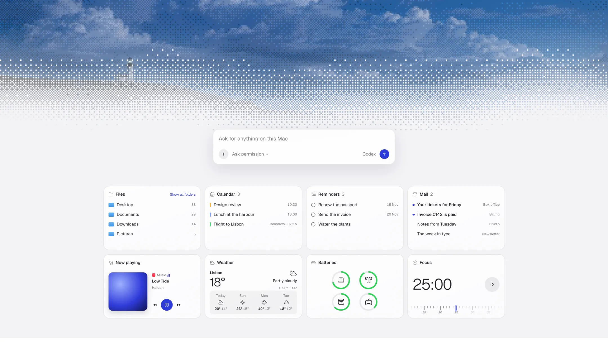

# Oree

**Your desktop, put to work.** Oree takes the place of the macOS desktop: a
picture across the top, a box to ask for anything, and the things you look at
all day laid out underneath.



[oree.space](https://oree.space)

## What is on it

| | |
| --- | --- |
| **Files** | Your Desktop and pinned folders, opened in place. Pick icons the way you do in Finder: click, Command-click, or drag a rectangle anywhere on the desktop. Drag to reorder, drop into folders, drag out to other apps. Stacks by kind, search, rename, compress. |
| **Calendar** | Today and tomorrow, in your calendars' colours. |
| **Reminders** | What is still open, soonest first. Tick one off from the desktop. |
| **Mail** | The newest messages across every inbox in Mail, Gmail's included. |
| **Now playing** | Whatever is playing in any app, with previous, play and next. |
| **Weather** | Now, and the next four days, where you are. |
| **Batteries** | This Mac, your earbuds and their case, keyboards and mice. |
| **Focus** | A 25-minute timer with a 5-minute break. One button. |

The picture is any image you choose. It is printed as a grid of dots and
dissolves into the desktop below it, so the picture and the widgets read as
one surface. Until you choose one, Oree follows your system wallpaper.

## The assistant

Type into the box and an agent goes to work on this Mac: find a file, say
what is in a folder, sum up a document. Select files first and the request is
about them. The conversation opens over the desktop, with the picture still
showing behind it.

Oree does not ship a model and holds no keys. It drives the command-line
agents you already have, signed in with your own account:

| Agent | Install | Sign in |
| --- | --- | --- |
| Claude Code | `npm install -g @anthropic-ai/claude-code` | `claude` |
| Codex | `npm install -g @openai/codex` | `codex login` |

Claude Code asks before it changes a file or runs a command, and Oree shows
you the question. Codex has no way to ask first, so Oree runs it read-only:
it can look around the Mac but change nothing.

## Build and run

Oree is a native Swift app (SwiftUI and AppKit, no web view). It needs
macOS 14 or later; the glass surfaces need macOS 26. Xcode's command line
tools are enough to build it.

```bash
./run.sh
```

This builds with Swift Package Manager, wraps the binary in `Oree.app`,
installs it to `/Applications` and starts it. `BUILD_ONLY=1 ./run.sh` stops
once the bundle is made.

## What it changes on your Mac

Being the desktop is something you turn on, at first launch or in Settings,
and turn off in Settings with "Give back to Finder". While it is on, Oree:

- registers a launch agent, so it starts at login and is started again if it
  ever stops;
- hides Finder's own desktop (`com.apple.finder CreateDesktop`);
- registers as the file viewer (`NSFileViewer`) and passes "Show in Finder"
  requests on to Finder.

Finder is never removed or modified, and turning the role off puts all three
back.

## What it asks to see

macOS asks once for each and remembers.

- **Calendar** and **Reminders**, for their widgets.
- **Location**, for the weather. The position is rounded to about a kilometre
  and sent to Open-Meteo; nothing else goes with it.
- **Automation for Mail**, to read your inbox while Mail is open.
- **Full Disk Access**, optional. With it your folders never ask and mail
  shows while Mail is closed. Without it each folder asks once, the first
  time you open it.

Nothing else leaves the Mac. There is no account and no telemetry.

## Good to know

- Now playing reads the system's now-playing information through a private
  macOS framework. A system update can break it, in which case the widget
  stays empty, and it keeps Oree out of the Mac App Store.
- Third-party keyboards and mice often do not report a battery level. They
  show as an empty ring.

## Credits

- Icons: [Hugeicons](https://hugeicons.com) free set, MIT. See
  [`ThirdParty/Hugeicons-LICENSE.md`](ThirdParty/Hugeicons-LICENSE.md).
- Weather: [Open-Meteo](https://open-meteo.com).
- Two projects showed how good a control surface for agents can look:
  [Zeron](https://github.com/zeronsh/zeron) and
  [Shipyard](https://github.com/cosscom/shipyard). Oree shares no code,
  assets or text with either.

## Licence

MIT. See [`LICENSE`](LICENSE).
